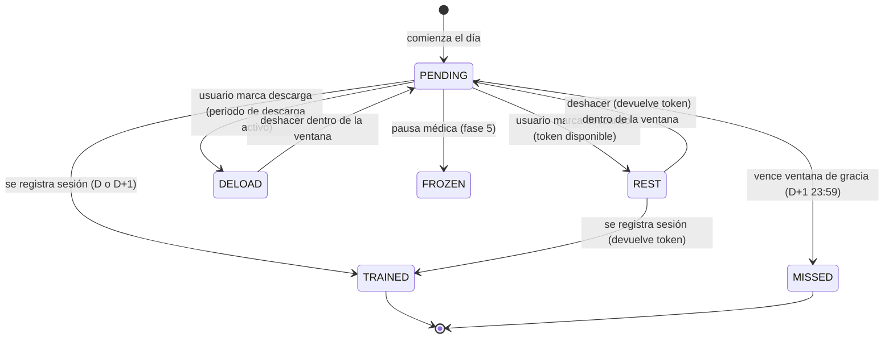
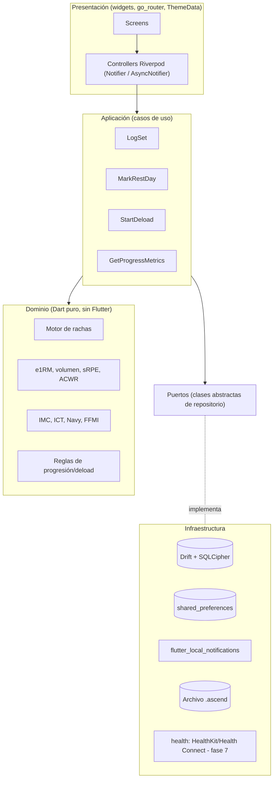
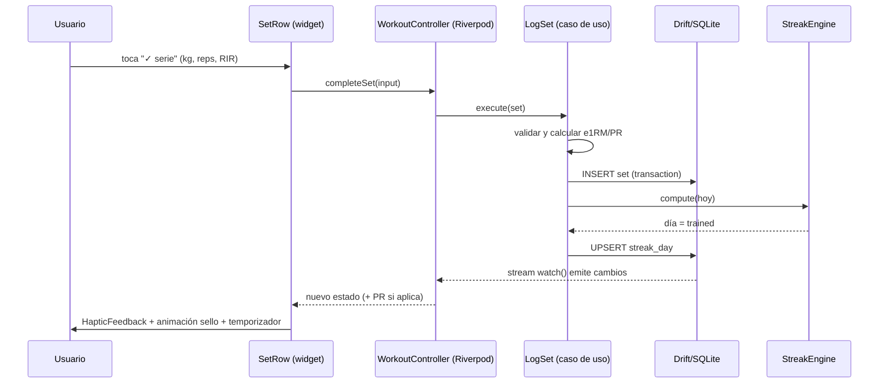
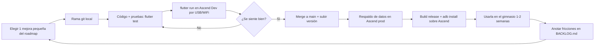
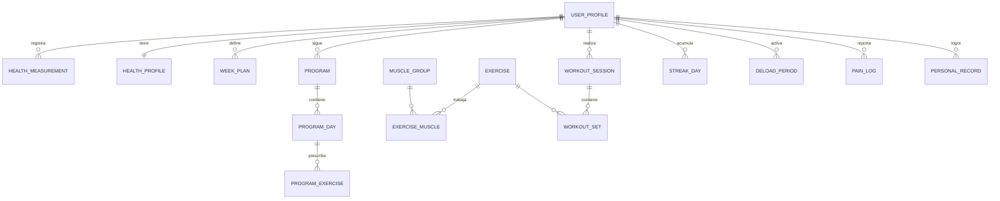
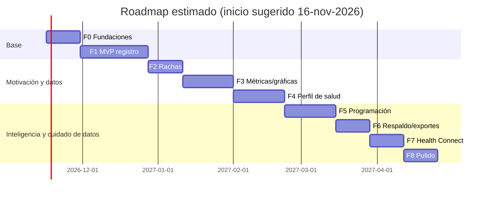

# Documento Técnico — **Ascend** · App de Registro de Entrenamiento

> **Versión:** 2.1 · **Fecha:** 9 de noviembre de 2026 · **Autor:** Roger (con asistencia de Claude)
> **Plataforma:** Flutter (Dart) · iOS + Android
> **Cambios v2.0:** migración del stack de React Native a **Flutter**; nombre oficial de la app: **Ascend**.
> **Cambios v2.1:** la app es **100 % local** (sin nube ni cuentas); desarrollo iterativo probando en tu propio celular Android; respaldo por archivo en lugar de sincronización (secciones 5.5 y 5.6). La nube queda como posible fase futura.
> **Estado:** Definición / pre-desarrollo

> ⚠️ **Aviso:** este documento y la app describen herramientas de seguimiento y educación. **No son un dispositivo médico** ni sustituyen la valoración de un médico, fisioterapeuta o entrenador certificado. Todas las métricas de salud se presentan como orientativas.

---

## Índice

0. [Resumen ejecutivo y supuestos](#0-resumen-ejecutivo-y-supuestos)
1. [Skills encontradas y cómo se usan](#1-skills-encontradas-y-cómo-se-usan)
2. [Alcance y requisitos](#2-alcance-y-requisitos)
3. [Marco técnico de entrenamiento y salud](#3-marco-técnico-de-entrenamiento-y-salud)
4. [Sistema de rachas (especificación completa)](#4-sistema-de-rachas-especificación-completa)
5. [Arquitectura de software](#5-arquitectura-de-software)
6. [Modelo de datos](#6-modelo-de-datos)
7. [Diseño UI/UX — identidad rojo/negro/blanco](#7-diseño-uiux--identidad-rojonegroblanco)
8. [Métricas y gráficas](#8-métricas-y-gráficas)
9. [Seguridad, privacidad y marco legal](#9-seguridad-privacidad-y-marco-legal)
10. [Calidad: pruebas, rendimiento y CI/CD](#10-calidad-pruebas-rendimiento-y-cicd)
11. [Roadmap por hitos alcanzables](#11-roadmap-por-hitos-alcanzables)
12. [Riesgos y decisiones abiertas (ADR)](#12-riesgos-y-decisiones-abiertas-adr)
13. [Referencias](#13-referencias)

---

## 0. Resumen ejecutivo y supuestos

**Qué es:** una app móvil para registrar entrenamientos de fuerza (ejercicios, series, repeticiones, carga, esfuerzo), con:

- **Perfil de salud** (cribado PAR-Q+, medidas corporales, presión, FC en reposo, lesiones/dolor).
- **Sistema de rachas** con *tokens de descanso* derivados del plan semanal (si entrenas 5 días → 2 tokens manuales) y **activación manual en días de descarga**.
- **Métricas y gráficas** de progreso de carga (1RM estimado, volumen por músculo, carga interna) y **métricas de salud explicadas** (qué son, para qué sirven, rango de referencia, limitaciones).
- **Diseño** rojo/negro/blanco inspirado en la paleta de Liebe (Black Clover), con **modo claro y oscuro**.

**Por qué Flutter (decisión ADR-01):**

| Criterio | Flutter | Impacto en Ascend |
|----------|---------|-------------------|
| Compilación | AOT a código máquina nativo (sin puente JS) | Arranque rápido, rendimiento estable en gama media |
| Render | Motor propio **Impeller** (Metal en iOS, Vulkan/OpenGL en Android) | Animaciones del sello de serie, racha y gráficas a 60/120 Hz sin *jank* |
| Diseño | Cada píxel lo dibuja Flutter: idéntico en iOS y Android | La identidad rojo/negro/blanco se ve exactamente igual en ambos |
| Widgets adaptativos | Material 3 + Cupertino + `.adaptive()` | Sensación nativa en cada plataforma (switches, diálogos, scroll) |
| Productividad | *Hot reload* con estado, DevTools | Iterar el diseño muy rápido |

**Supuestos tomados (modificables):**

| # | Supuesto | Motivo |
|---|----------|--------|
| S1 | **Flutter (canal stable, ≥ 3.41) + Dart 3** con análisis estricto (`strict-casts`, `strict-raw-types`) | Compilación AOT a código nativo ARM, motor de render **Impeller** (animaciones fluidas y consistentes), control total del diseño pixel a pixel, un solo código para iOS y Android |
| S2 | **Local-first / offline-first** (SQLite en el dispositivo vía Drift) | En el gimnasio la señal suele ser mala; la app debe funcionar sin red |
| S3 | **Sin nube por ahora:** sin servidor, sin cuentas, sin sincronización. Respaldo mediante archivo exportable | Decisión del usuario; foco en construir y probar en el propio dispositivo |
| S4 | Usuario único (uso personal), app instalada en tu celular Android desde tu computador Linux; sin publicación en tiendas por ahora | Iterar rápido y mejorar con el uso real |
| S5 | Idioma base español, preparado para i18n | Usuario en Colombia |
| S6 | Semana ISO (lunes–domingo) en zona horaria local del dispositivo | Necesario para el cálculo de tokens de racha |

---

## 1. Skills encontradas y cómo se usan

### 1.1 Nota sobre `find-skills`

La skill `find-skills` está instalada en **tu computador** (no en esta sesión en la nube), y su comando (`npx skills find <consulta>`) no pudo ejecutarse desde aquí porque la red de esta sesión bloquea npm y skills.sh. La búsqueda equivalente se hizo en: (a) las skills habilitadas en esta sesión, (b) el catálogo público de skills (búsqueda web) y (c) la documentación oficial de Flutter. **Recomendación:** al empezar, ejecuta en tu equipo `npx skills find flutter`, `npx skills find dart`, `npx skills find riverpod` para confirmar nombres y versiones.

### 1.2 Skills oficiales de Flutter y Dart (prioridad máxima)

El equipo de Flutter publica skills oficiales para agentes ([docs.flutter.dev/ai/agent-skills](https://docs.flutter.dev/ai/agent-skills)):

| Repositorio | Contenido | Instalación (desde la raíz del proyecto) |
|-------------|-----------|------------------------------------------|
| `flutter/agent-plugins` | Skills y reglas de Flutter (widgets, layout, rendimiento, pruebas, plataforma) | `npx skills add flutter/agent-plugins --skill '*' --agent universal --yes` |
| `dart-lang/skills` | Skills de Dart (lenguaje, async, paquetes, análisis estático) | `npx skills add dart-lang/skills --skill '*' --agent universal --yes` |

**Para Claude Code** (ruta de plugin):

```bash
claude plugin marketplace add flutter/agent-plugins
claude plugin install dart-flutter@dart-flutter
```

> Las *rules* de `flutter/agent-plugins/rules` no se cargan automáticamente en Claude Code: hay que copiarlas al `CLAUDE.md` del proyecto.

### 1.3 Skills de la comunidad recomendadas

> Verifica cada una con `find-skills` antes de instalar; la calidad de las skills comunitarias varía.

| Skill | Uso en Ascend |
|-------|---------------|
| `flutter-expert` (rmyndharis/antigravity-skills) | Patrones de producción Flutter, arquitectura |
| `riverpod` (evanca/flutter-ai-rules) | Reglas de uso de Riverpod (gestión de estado) |
| `flutter-riverpod-expert` (juparave/dotfiles) | Riverpod + generación de código |
| `riverpod-scoping`, `riverpod-retry` (serverpod/skills-registry) | Alcance de providers y reintentos en sincronización |
| `dart-expert` (personamanagmentlayer/pcl) | Dart idiomático, null-safety, patrones |
| `flutter` (alinaqi/claude-bootstrap) | Arranque de proyecto Flutter con convenciones |

### 1.4 Skills disponibles en esta sesión (ya utilizables)

| Skill | Para qué en este proyecto | Fases |
|-------|---------------------------|-------|
| `frontend-design` | Dirección estética, tipografía, evitar diseños genéricos (aplicable a cualquier framework) | 0, 3, 8 |
| `dataviz` | Reglas de color de gráficas, accesibilidad, coherencia claro/oscuro, *stat tiles*, sparklines | 3 |
| `supabase-postgres-best-practices` | Buenas prácticas de esquema, índices y migraciones SQL (aplican también a SQLite/Drift) | 0, 6 |
| `supabase` | **Pospuesta** — solo si en el futuro se añade nube | Futuro |
| `skill-creator` | Crear una skill propia de Ascend (convenciones, motor de rachas) | Transversal |
| `xlsx` / `pdf` | Plantillas de exportación de historial / informe de salud | 6 |

> La skill `react-native-best-practices` **ya no aplica** tras el cambio a Flutter.

**No se encontró** ninguna skill específica de «ciencia del entrenamiento». Toda la sección 3 proviene de literatura científica y guías clínicas (sección 13).

### 1.5 Matriz skill → entregable

```
Fase 0 Fundaciones ......... flutter/agent-plugins, dart-lang/skills, frontend-design
Fase 1 Registro (MVP) ...... flutter/agent-plugins, riverpod, dart-expert
Fase 2 Rachas .............. dart-lang/skills (lógica pura) + skill-creator para documentar el motor
Fase 3 Métricas/gráficas ... dataviz, frontend-design, flutter-expert
Fase 4 Perfil de salud ..... (sección 3 de este documento)
Fase 5 Programación/deload . (sección 3)
Fase 6 Respaldo/exportes ... dart-lang/skills, xlsx, pdf
Fase 7 Integraciones ....... flutter/agent-plugins (plataforma Android: Health Connect)
Fase 8 Pulido ............... flutter/agent-plugins, frontend-design
```

---

## 2. Alcance y requisitos

### 2.1 Requisitos funcionales (RF)

| ID | Requisito | Fase |
|----|-----------|------|
| RF-01 | Crear/editar ejercicios (nombre, grupo muscular primario/secundario, equipo, tipo: compuesto/aislado, unilateral) | 1 |
| RF-02 | Biblioteca precargada de ~120 ejercicios comunes | 1 |
| RF-03 | Registrar sesión: ejercicios → series (reps, carga kg/lb, RIR o RPE, tipo: calentamiento/efectiva/drop/fallo, notas) | 1 |
| RF-04 | Temporizador de descanso entre series con notificación local | 1 |
| RF-05 | Ver historial por fecha y por ejercicio; repetir sesión anterior | 1 |
| RF-06 | Definir **plan semanal** (días de entrenamiento / semana, sistema: full body, torso-pierna, PPL, weider, personalizado) | 2 |
| RF-07 | **Rachas**: cálculo automático, tokens de descanso manuales, activación manual en descarga | 2 |
| RF-08 | Calendario visual de racha (heatmap) | 2 |
| RF-09 | 1RM estimado, récords personales (PR) automáticos | 3 |
| RF-10 | Volumen semanal por grupo muscular vs rangos objetivo | 3 |
| RF-11 | Carga interna (sRPE), monotonía, tensión, ratio agudo:crónico (informativo) | 3 |
| RF-12 | Onboarding con cuestionario PAR-Q+ y perfil de salud | 4 |
| RF-13 | Registro de medidas: peso, cintura, cuello, cadera, % grasa, PA, FC reposo, sueño | 4 |
| RF-14 | Fichas educativas por métrica (qué es, para qué sirve, rango, limitaciones) | 4 |
| RF-15 | Registro de dolor/molestias (zona, 0–10) con alertas de derivación | 4 |
| RF-16 | Programas con mesociclos y semanas de descarga planificadas o sugeridas | 5 |
| RF-17 | Sugerencias de progresión de carga (doble progresión, por RIR) | 5 |
| RF-18 | Respaldo y restauración local por archivo (exportar/importar), respaldo automático semanal en el dispositivo | 1 (básico) / 6 |
| RF-19 | Integración Health Connect (Android) — y Apple Health si algún día se compila en iOS (peso, FC, sueño, pasos) | 7 |
| RF-20 | Exportar CSV/XLSX/PDF | 6 |

### 2.2 Requisitos no funcionales (RNF)

| ID | Requisito | Métrica de aceptación |
|----|-----------|-----------------------|
| RNF-01 | Offline-first | 100 % de funciones de registro sin red |
| RNF-02 | Rendimiento | Arranque en frío < 2 s en gama media; registrar una serie ≤ 2 toques; listas a 60 fps |
| RNF-03 | Accesibilidad | Contraste WCAG AA (≥ 4.5:1 texto), objetivos táctiles ≥ 44×44 pt, soporte lector de pantalla y tamaño de fuente dinámico |
| RNF-04 | Privacidad | Datos de salud cifrados en reposo; bloqueo biométrico opcional |
| RNF-05 | Fiabilidad | Sin pérdida de datos ante cierre forzado (escritura transaccional por serie) |
| RNF-06 | Mantenibilidad | Cobertura de pruebas ≥ 90 % en dominio (rachas, métricas); análisis estático estricto de Dart (`very_good_analysis`) |
| RNF-07 | Temas | Claro/oscuro/sistema, cambio en caliente |
| RNF-08 | Internacionalización | Textos externalizados; unidades kg/lb y cm/in |

---

## 3. Marco técnico de entrenamiento y salud

Esta sección es la «verdad de negocio» de la app. Cada fórmula aquí se implementa como **función pura** en la capa de dominio (ver 5.3) y se prueba con casos de la literatura.

### 3.1 Variables de entrenamiento que se registran

| Variable | Definición | Cómo se registra | Uso en la app |
|----------|-----------|------------------|---------------|
| **Carga** | Peso movido (kg) | Por serie | Progresión, tonelaje, 1RM |
| **Repeticiones** | Repeticiones completadas | Por serie | 1RM, volumen |
| **RIR** | *Reps in Reserve*: repeticiones que quedaban antes del fallo (0–5+) | Por serie (opcional) | Esfuerzo, serie efectiva, autoregulación |
| **RPE** | Esfuerzo percibido 1–10 (RPE = 10 − RIR en la escala de Zourdos et al.) | Alternativa al RIR | Igual que RIR |
| **Tipo de serie** | Calentamiento / efectiva / drop set / al fallo / back-off | Por serie | Calentamientos se excluyen del volumen |
| **sRPE de sesión** | Esfuerzo global de la sesión 0–10 (escala CR-10 de Foster) | Al terminar la sesión | Carga interna |
| **Duración** | Minutos de la sesión | Automático (inicio–fin) | Carga interna, densidad |
| **Dolor** | Zona + intensidad 0–10 | Opcional por ejercicio/sesión | Seguridad |

### 3.2 Fórmulas de rendimiento

#### 3.2.1 1RM estimado (e1RM)

Se usan dos fórmulas clásicas y se muestra el **promedio**; solo se calcula con series de **1–10 repeticiones** (por encima de 10 el error crece mucho).

```
Epley:    e1RM = w × (1 + r / 30)
Brzycki:  e1RM = w × 36 / (37 − r)
```

Si hay RIR, se usan las repeticiones potenciales: `r_ajustadas = r + RIR`. Ejemplo: 100 kg × 5 @ RIR 2 → se calcula como 7 reps → Epley 123.3 kg, Brzycki 120.0 kg → **e1RM ≈ 121.7 kg**.

**Para qué sirve:** comparar el progreso de fuerza aunque cambies el rango de repeticiones. **Limitación:** es una estimación; varía según ejercicio y persona (±5–10 %).

#### 3.2.2 Volumen

| Métrica | Fórmula | Para qué sirve |
|---------|---------|----------------|
| **Tonelaje (volume load)** | Σ (carga × reps) de series efectivas | Trabajo mecánico total; tendencia de carga |
| **Series efectivas por músculo/semana** | Σ series con RIR ≤ 4 (o sin RIR registrado y no calentamiento). Músculo primario = 1 serie, secundario = 0.5 | **Principal métrica de hipertrofia** |
| **Densidad** | Tonelaje / minutos | Eficiencia de la sesión |

**Rangos de referencia (series efectivas por músculo por semana)** — basados en la relación dosis-respuesta (Schoenfeld et al., 2017; Pelland et al., 2024), donde más volumen da más hipertrofia con **rendimientos decrecientes**:

| Zona | Series/semana | Interpretación en la app |
|------|---------------|--------------------------|
| Mantenimiento | < 6 | «Mantienes, pero difícilmente progresas» |
| Productiva | 6–10 | «Rango eficaz para la mayoría» |
| Alta | 10–20 | «Mayor estímulo; vigila recuperación» |
| Muy alta | > 20 | «Rendimientos decrecientes; riesgo de fatiga acumulada» |

Los umbrales son **configurables** por usuario (los «landmarks» MEV/MAV/MRV son individuales).

#### 3.2.3 Carga interna y fatiga (modelo de Foster)

```
Carga de sesión (UA)   = sRPE (0–10) × duración (min)
Carga semanal          = Σ cargas de sesión de la semana
Monotonía              = media(carga diaria, 7 días) / desviación estándar(carga diaria, 7 días)
Tensión (strain)       = carga semanal × monotonía
ACWR (EWMA)            = media exponencial 7 días / media exponencial 28 días
```

| Métrica | Interpretación orientativa |
|---------|---------------------------|
| Monotonía > 2.0 | Entrenamiento poco variado día a día; considera alternar días duros/suaves |
| ACWR 0.8–1.3 | Aumento de carga gradual |
| ACWR > 1.5 | Pico brusco de carga respecto a lo habitual |

> **Advertencia científica:** el ACWR ha recibido críticas metodológicas importantes (Impellizzeri et al., 2020/2021) y **no predice lesiones de forma fiable**. En la app se muestra solo como indicador de «¿subí la carga muy rápido?», nunca como riesgo de lesión.

#### 3.2.4 Progresión de carga (fase 5)

- **Doble progresión:** rango objetivo (ej. 8–12). Si todas las series alcanzan el tope con RIR ≥ 1 → subir carga (2.5 kg tren superior, 5 kg tren inferior, o 2–5 %).
- **Por RIR:** si el RIR real < objetivo − 1 durante 2 sesiones → mantener o bajar carga; si RIR real > objetivo + 1 → subir.
- **Estancamiento:** e1RM sin mejora ≥ 3 semanas + sRPE en ascenso → sugerir descarga.

### 3.3 Descarga (deload)

**Definición:** periodo planificado (normalmente ~1 semana) de reducción del estrés de entrenamiento para disipar fatiga y favorecer la adaptación. El consenso Delphi de Bell et al. (2023) describe la descarga típicamente cada **4–8 semanas**, con duración de ~**7 días**, reduciendo principalmente el **volumen** (series/reps) y manteniendo o reduciendo ligeramente la intensidad.

**Plantillas de descarga en la app:**

| Tipo | Volumen | Intensidad (carga) | RIR objetivo |
|------|---------|--------------------|--------------|
| Volumen (por defecto) | −40 a −50 % series | Igual | +2 |
| Intensidad | Igual | −10 a −20 % | +2 |
| Mixta | −30 % | −10 % | +2–3 |
| Descanso activo | Movilidad/cardio suave | — | — |

**Disparadores para sugerirla (fase 5):** 4–8 semanas desde la última descarga, estancamiento del e1RM, sRPE medio en ascenso con rendimiento estable o bajando, sueño < 6 h varios días, dolor recurrente ≥ 3/10.

### 3.4 Perfil de salud y cribado

#### 3.4.1 Cribado inicial (onboarding)

Se implementa el **PAR-Q+** (Physical Activity Readiness Questionnaire for Everyone). Si alguna respuesta es «sí» → la app muestra un aviso recomendando consultar a un profesional de salud antes de aumentar la intensidad, y guarda la fecha del cribado (se repite cada 12 meses o ante cambios).

Datos clínicos opcionales: condiciones (hipertensión, diabetes, asma, cardiopatía), medicamentos relevantes (ej. betabloqueantes alteran la FC), lesiones previas, cirugías, embarazo.

#### 3.4.2 Métricas de salud — fichas educativas

Cada métrica tiene en la app una ficha con: **qué es · cómo se mide · fórmula · rango · para qué te sirve · limitaciones**. Los colores de estado nunca van solos: siempre llevan icono + texto.

| Métrica | Fórmula / medida | Rango de referencia (adultos) | Para qué te sirve | Limitación |
|---------|------------------|-------------------------------|-------------------|------------|
| **IMC** | peso (kg) / talla (m)² | 18.5–24.9 normal; 25–29.9 sobrepeso; ≥ 30 obesidad (OMS) | Cribado poblacional rápido | No distingue músculo de grasa: en personas musculadas sobreestima |
| **Índice cintura-talla (ICT)** | cintura (cm) / talla (cm) | < 0.5 riesgo bajo; 0.5–0.6 aumentado; > 0.6 alto | Mejor indicador de grasa abdominal y riesgo cardiometabólico que el IMC | Medir siempre igual (punto medio entre costilla y cresta ilíaca, al exhalar) |
| **% grasa (método US Navy)** | Hombre: 495 / (1.0324 − 0.19077·log10(cintura − cuello) + 0.15456·log10(talla)) − 450 · Mujer: 495 / (1.29579 − 0.35004·log10(cintura + cadera − cuello) + 0.22100·log10(talla)) − 450 (cm) | Orientativo hombres ~10–20 %, mujeres ~18–28 % | Seguir tendencia de composición corporal | Error ± 3–4 %; usar tendencia, no valor puntual |
| **Masa magra y FFMI** | MM = peso × (1 − %grasa) · FFMI = MM / talla² · FFMI normalizado = FFMI + 6.1 × (1.8 − talla) | Hombres ~18–20 promedio, > 22 muy musculado; mujeres ~14–17 | Ver si ganas músculo y no solo peso | Hereda el error del % grasa |
| **Presión arterial** | Tensiómetro validado, sentado, 5 min reposo | Normal < 120/< 80; elevada 120–129/< 80; HTA 1: 130–139 o 80–89; HTA 2: ≥ 140 o ≥ 90 (AHA/ACC 2017). **> 180 y/o > 120 → atención médica** | El ejercicio de fuerza y aeróbico ayuda a bajarla; detectar valores que requieren consulta | Una toma aislada no diagnostica; promediar varias |
| **FC en reposo** | Pulsaciones al despertar, 60 s | 60–100 lpm normal; < 60 frecuente en personas entrenadas | Su descenso a largo plazo refleja mejor forma cardiovascular; un aumento sostenido de +5–7 lpm sobre tu línea base puede indicar fatiga, enfermedad o mal sueño | Afectada por café, estrés, medicamentos |
| **Sueño** | Horas/noche (manual o Health) | ≥ 7 h adultos (AASM/SRS) | La recuperación muscular y el rendimiento dependen del sueño | Autorreporte impreciso |
| **Proteína diaria (opcional)** | g/kg/día | ~1.6 g/kg/día para maximizar ganancias de masa magra (Morton et al., 2018), hasta ~2.2 | Asegurar el sustrato para crecer | Personas con enfermedad renal: consultar al médico |
| **Fuerza relativa** | e1RM / peso corporal | Por ejercicio (tablas estándar) | Comparar tu fuerza ajustada a tu tamaño | Depende de técnica y palancas |
| **Minutos de actividad** | Σ semanal | OMS 2020: 150–300 min moderada o 75–150 vigorosa **+ fuerza ≥ 2 días/semana** | Saber si cumples la recomendación de salud | — |

**Por qué entrenar fuerza es salud (mensaje de la app):** el metaanálisis de Momma et al. (2022, BJSM) asocia **30–60 min/semana** de actividad de fortalecimiento muscular con un **~10–20 % menos de riesgo** de mortalidad por todas las causas, enfermedad cardiovascular y cáncer; y su combinación con ejercicio aeróbico muestra un beneficio aún mayor.

#### 3.4.3 Dolor y banderas rojas

| Situación | Respuesta de la app |
|-----------|---------------------|
| Dolor ≤ 3/10 que no empeora durante/después | «Aceptable; vigila la tendencia» |
| Dolor 4–6/10 o que empeora al día siguiente | Sugerir reducir carga/rango en ese ejercicio y registrar evolución |
| Dolor ≥ 7/10, dolor agudo súbito, chasquido con pérdida de función, hinchazón | «Detén el ejercicio y consulta a un profesional» |
| Dolor torácico, mareo, falta de aire desproporcionada, palpitaciones | **Aviso urgente**: detener y buscar atención médica |
| Mismo punto de dolor ≥ 3 sesiones seguidas | Sugerir valoración por fisioterapeuta |

### 3.5 Sistemas de entrenamiento soportados

| Sistema | Días/semana típicos | Tokens de descanso (7 − N) |
|---------|--------------------|-----------------------------|
| Full body | 2–4 | 5–3 |
| Torso / Pierna | 4 | 3 |
| Push / Pull / Legs | 3 o 6 | 4 o 1 |
| Weider (rutina dividida por músculo) | 5 | 2 |
| Upper/Lower + PPL (híbrido) | 5 | 2 |
| Personalizado | 1–7 | 7 − N |

---
## 4. Sistema de rachas (especificación completa)

### 4.1 Objetivo

Premiar la **consistencia con el plan**, no entrenar todos los días. El descanso es parte del entrenamiento, por eso la racha se mantiene en días de descanso, pero de forma **limitada y consciente** (manual), para que no se convierta en una racha «gratis».

### 4.2 Reglas de negocio

| ID | Regla |
|----|-------|
| R-01 | El usuario define **N = días de entrenamiento planificados por semana** (1–7) según su sistema. |
| R-02 | Cada semana ISO (lunes 00:00 – domingo 23:59, hora local) otorga **T = 7 − N tokens de descanso**. Ej.: 5 días → 2 tokens; 4 días → 3; 6 días → 1; 7 días → 0. |
| R-03 | Un día con **al menos una sesión registrada** (≥ 1 serie efectiva) es `TRAINED` y **mantiene la racha automáticamente**. No consume token. |
| R-04 | Un día sin entrenamiento puede marcarse **manualmente** como `REST` consumiendo **1 token**. Mantiene la racha. |
| R-05 | Si no quedan tokens, no se puede marcar `REST`. El día queda `MISSED` al cerrarse la ventana de gracia → **la racha se rompe**. |
| R-06 | **Ventana de gracia:** un día D puede marcarse (REST o DELOAD) hasta las 23:59 del día D+1. Pasado ese plazo se cierra como `MISSED`. Las sesiones de entrenamiento olvidadas sí pueden registrarse después, pero solo cuentan para la racha si se registran dentro de la ventana de gracia. |
| R-07 | Los tokens **no se acumulan** entre semanas. |
| R-08 | **Semana de descarga:** el usuario activa manualmente un periodo de descarga (por defecto 7 días, máx. 10). Durante ese periodo, cada día sin sesión puede marcarse manualmente como `DELOAD`, **sin consumir tokens**. Los días con sesión cuentan como `TRAINED` (con la marca `isDeload` para métricas). |
| R-09 | **Anti-abuso de descarga:** solo se puede activar una descarga si han pasado **≥ 3 semanas** desde el fin de la anterior (configurable 3–8). La app muestra cuándo estará disponible la siguiente. |
| R-10 | Los días `DELOAD` también son manuales: si no se marca el día dentro de la ventana de gracia → `MISSED`. |
| R-11 | Cambio de plan (N) a mitad de semana → aplica **desde la semana siguiente**. La semana en curso conserva sus tokens. |
| R-12 | La **primera semana** (alta del usuario a mitad de semana) recibe tokens prorrateados: `T = floor((7 − N) × díasRestantes / 7)`, mínimo 0. |
| R-13 | Entrenar en un día planificado como descanso: cuenta como `TRAINED` y el token no se gasta. |
| R-14 | (Fase 5, opcional) **Pausa médica**: congelar la racha por enfermedad/lesión, máx. 14 días/trimestre; los días quedan `FROZEN` (ni suman ni rompen). |
| R-15 | El valor de la racha = número de días consecutivos en estado `TRAINED`, `REST`, `DELOAD` (y `FROZEN` no suma pero no rompe). Se guarda **racha actual** y **mejor racha**. |

### 4.3 Estados de un día



### 4.4 Ejemplos

**Plan 5 días (Weider), 2 tokens:**

| Lun | Mar | Mié | Jue | Vie | Sáb | Dom | Racha |
|-----|-----|-----|-----|-----|-----|-----|-------|
| TRAINED | TRAINED | REST (token 1) | TRAINED | TRAINED | TRAINED | REST (token 2) | +7 ✅ |
| TRAINED | REST (1) | REST (2) | sin marcar → MISSED | … | | | Se rompe el jueves ❌ |

**Semana de descarga (plan 4 días, 3 tokens):** el usuario activa descarga el lunes. Entrena suave lun/mié/vie (TRAINED + isDeload) y marca mar/jue/sáb/dom como `DELOAD` → +7 sin gastar tokens; los 3 tokens de esa semana quedan sin uso.

### 4.5 Motor de rachas (dominio puro, Dart)

```dart
// lib/domain/streak/streak_types.dart
enum DayStatus { pending, trained, rest, deload, frozen, missed }

@immutable
class DayRecord {
  const DayRecord({required this.date, required this.status, this.isDeload = false, this.markedAt});
  final LocalDate date;          // fecha local sin hora (value object propio)
  final DayStatus status;
  final bool isDeload;
  final DateTime? markedAt;      // momento de la acción manual
  DayRecord copyWith({DayStatus? status}) =>
      DayRecord(date: date, status: status ?? this.status, isDeload: isDeload, markedAt: markedAt);
}

class WeekPlan { const WeekPlan(this.weekStart, this.plannedDays); final LocalDate weekStart; final int plannedDays; }
class DeloadPeriod { const DeloadPeriod(this.start, this.end); final LocalDate start, end;
  bool contains(LocalDate d) => !d.isBefore(start) && !d.isAfter(end); }

enum StreakError { graceExpired, alreadyTrained, noTokens, noActiveDeload, deloadCooldown }

// Resultado sellado (Dart 3)
sealed class Check { const Check(); }
final class Allowed extends Check { const Allowed(); }
final class Denied extends Check { const Denied(this.reason); final StreakError reason; }

// lib/domain/streak/streak_engine.dart
class StreakEngine {
  const StreakEngine({this.minDeloadGapWeeks = 3});
  final int minDeloadGapWeeks;

  int tokensForWeek(int plannedDays) => (7 - plannedDays).clamp(0, 7);

  bool withinGrace(LocalDate day, LocalDate today) => today.difference(day).inDays <= 1; // hasta D+1 23:59

  int tokensLeft(WeekPlan week, List<DayRecord> days) {
    final used = days.where((d) => d.date.isInWeek(week.weekStart) && d.status == DayStatus.rest).length;
    return tokensForWeek(week.plannedDays) - used;
  }

  Check canMarkRest(LocalDate day, LocalDate today, WeekPlan week, List<DayRecord> days) {
    if (!withinGrace(day, today)) return const Denied(StreakError.graceExpired);
    if (days.any((d) => d.date == day && d.status == DayStatus.trained)) return const Denied(StreakError.alreadyTrained);
    if (tokensLeft(week, days) <= 0) return const Denied(StreakError.noTokens);
    return const Allowed();
  }

  Check canMarkDeload(LocalDate day, LocalDate today, List<DeloadPeriod> periods) {
    if (!withinGrace(day, today)) return const Denied(StreakError.graceExpired);
    if (!periods.any((p) => p.contains(day))) return const Denied(StreakError.noActiveDeload);
    return const Allowed();
  }

  Check canStartDeload(LocalDate today, List<DeloadPeriod> periods) {
    if (periods.isEmpty) return const Allowed();
    final gap = today.difference(periods.last.end).inDays;
    return gap < minDeloadGapWeeks * 7 ? const Denied(StreakError.deloadCooldown) : const Allowed();
  }

  /// Cierra días vencidos y calcula racha actual y mejor racha. Idempotente.
  ({int current, int best, List<DayRecord> days}) compute(List<DayRecord> input, LocalDate today) {
    final closed = [
      for (final d in input)
        d.status == DayStatus.pending && !withinGrace(d.date, today) ? d.copyWith(status: DayStatus.missed) : d
    ]..sort((a, b) => a.date.compareTo(b.date));
    var current = 0, best = 0;
    for (final d in closed) {
      switch (d.status) {
        case DayStatus.missed: current = 0;
        case DayStatus.frozen || DayStatus.pending: continue; // ni suma ni rompe
        case DayStatus.trained || DayStatus.rest || DayStatus.deload:
          current++; if (current > best) best = current;
      }
    }
    return (current: current, best: best, days: closed);
  }
}
```

**Diseño clave:**

- El motor es **Dart puro** (sin `package:flutter`), **determinista** (recibe `today` como parámetro, nunca llama a `DateTime.now()`; se inyecta un `Clock`), y se prueba con `package:test` + *property-based testing* (`glados`): «la racha nunca supera el número de días», «nunca se usan más de 7 − N tokens por semana», «marcar y deshacer devuelve el mismo estado».
- `LocalDate` es un *value object* propio (año-mes-día) para evitar errores de hora/zona horaria al comparar días.
- El estado de cada día se **materializa** en la tabla `streak_days` para leer rápido; el motor puede recalcular todo desde cero (fuente de verdad = sesiones + marcas manuales).
- Recalcular al abrir la app (`AppLifecycleState.resumed`), al registrar sesión y en segundo plano diario con **`workmanager`** (Android) / *BGTaskScheduler* (iOS, best-effort).

### 4.6 UX de la racha

- **Contador** grande con llama/sello rojo; mejor racha debajo.
- **Fichas de tokens** de la semana (ej. ●●○ = 2 de 3 disponibles).
- Botón **«Marcar descanso»** visible solo en días sin sesión y con tokens; **«Marcar descarga»** visible solo durante un periodo de descarga.
- **Recordatorio** local a las 20:00 si el día está `PENDING` y es día planificado («¿Entrenaste o marcamos descanso?»), y a las 12:00 del día D+1 si sigue pendiente (último aviso).
- **Calendario heatmap**: rojo intenso = entrenado, rojo tenue = descanso, patrón rayado = descarga, gris = perdido, contorno = pendiente.
- Hitos: 7, 30, 50, 100, 365 días (insignias desbloqueables «niveles de ascenso»).

---

## 5. Arquitectura de software

### 5.1 Stack tecnológico (Flutter)

| Capa | Tecnología (paquete pub.dev) | Justificación |
|------|------------------------------|---------------|
| Framework | **Flutter stable (≥ 3.41)** · Dart 3 · motor **Impeller** | AOT nativo, render consistente, *hot reload* |
| Lenguaje / análisis | Dart 3 con `very_good_analysis` o `flutter_lints` + modos estrictos | Seguridad de tipos, *sealed classes*, *records*, *pattern matching* |
| Navegación | **go_router** (rutas declarativas, `StatefulShellRoute` para tabs) | Deep links, tabs con estado preservado |
| Estado | **Riverpod 3** (`flutter_riverpod` + `riverpod_generator`) | Inyección de dependencias + estado reactivo + caché async; fácil de probar |
| Base de datos local | **Drift** (SQLite tipado, *streams* reactivos, migraciones) + `sqlite3_flutter_libs` | Consultas agregadas para gráficas, `watch()` reactivo a la UI, offline |
| Cifrado de BD | **sqlcipher_flutter_libs** (Drift sobre SQLCipher) | Datos de salud cifrados en reposo |
| Preferencias | **shared_preferences** (`SharedPreferencesAsync`) | Tema, unidades, flags |
| Modelos inmutables | **freezed** + **json_serializable** | `copyWith`, igualdad por valor, uniones |
| Formularios / validación | **reactive_forms** o validadores propios en dominio | Series, medidas |
| Gráficas | **fl_chart** (línea, barras, área) + `CustomPainter` para heatmap y sellos | Personalizable, animado, sin dependencias nativas |
| Animaciones | API implícita/explícita de Flutter + **flutter_animate**; **rive** opcional para insignias | Micro-animaciones fluidas con Impeller |
| Listas | `ListView.builder` / `SliverList` (construcción perezosa) | Historial largo a 60/120 Hz |
| Notificaciones | **flutter_local_notifications** + **timezone** | Descanso entre series, recordatorios de racha |
| Segundo plano | **workmanager** | Cierre diario de rachas |
| Seguridad | **flutter_secure_storage** (Keychain/Keystore), **local_auth** (biometría) | Clave de BD, bloqueo |
| Fechas / i18n | **intl** + `flutter_localizations` (ARB, `gen-l10n`) | Español base, formatos locales, semana ISO |
| Tipografías | **google_fonts** (o fuentes empaquetadas en `assets/fonts`) | Barlow Condensed, IBM Plex |
| Hápticos | `HapticFeedback` (servicios de Flutter) | Feedback al completar serie |
| Respaldo local | **share_plus**, **file_picker**, **path_provider**, **archive** (gzip), **cryptography** (AES-GCM opcional) | Exportar/importar el archivo `.ascend` |
| Salud (fase 7) | **health** (HealthKit + Health Connect en un solo API) | Peso, FC, sueño, pasos, escribir entrenamientos |
| Exportes (fase 6) | **pdf** + **printing**, **excel** / **csv**, **share_plus** | Informes y respaldo |
| Diagnóstico local | **logger** + archivo rotativo, pantalla oculta «Diagnóstico» | Errores sin enviar datos a servicios externos |
| Calidad | `flutter_test`, `mocktail`, **glados** (propiedades), golden tests (**alchemist**), `integration_test` + **patrol** o **Maestro** | Ver sección 10 |

### 5.2 Vista de arquitectura (Clean Architecture + features)



**Regla de dependencias:** Presentación → Aplicación → Dominio. La infraestructura implementa clases abstractas (`WorkoutRepository`, `StreakRepository`, `HealthRepository`) definidas en Aplicación, y se inyectan con **providers de Riverpod** (en pruebas se sobrescriben con `ProviderScope(overrides: …)`). El dominio no importa `package:flutter` → se prueba con `dart test`, muy rápido.

### 5.3 Estructura de carpetas

```
ascend/
├─ lib/
│  ├─ main.dart                     # bootstrap común: DB, ProviderScope, logger
│  ├─ main_dev.dart / main_prod.dart # puntos de entrada por flavor
│  ├─ app/
│  │  ├─ app.dart                   # MaterialApp.router, temas claro/oscuro
│  │  └─ router.dart                # go_router: onboarding + StatefulShellRoute (5 tabs)
│  ├─ domain/                       # Dart puro
│  │  ├─ common/ (local_date.dart, result.dart, units.dart)
│  │  ├─ streak/ (streak_types.dart, streak_engine.dart)
│  │  ├─ metrics/ (e1rm.dart, volume.dart, training_load.dart)
│  │  ├─ health/ (bmi.dart, whtr.dart, navy_body_fat.dart, ffmi.dart, blood_pressure.dart)
│  │  └─ progression/ (double_progression.dart, deload_rules.dart)
│  ├─ application/
│  │  ├─ ports/ (workout_repository.dart, streak_repository.dart, health_repository.dart)
│  │  └─ usecases/ (log_set.dart, mark_rest_day.dart, start_deload.dart, ...)
│  ├─ infrastructure/
│  │  ├─ db/ (app_database.dart, tables/*.dart, migrations/)   # Drift
│  │  ├─ repositories/ (drift_workout_repository.dart, ...)
│  │  ├─ notifications/  ├─ background/  ├─ backup/ (export/import .ascend)  └─ health/ (fase 7)
│  ├─ features/                     # UI por feature: screens/, widgets/, controllers/
│  │  ├─ today/  ├─ workout/  ├─ history/  ├─ progress/  ├─ health/  ├─ exercises/  └─ onboarding/
│  ├─ ui/
│  │  ├─ theme/ (ascend_colors.dart, ascend_theme.dart, typography.dart)  # ThemeExtension
│  │  └─ components/ (ascend_button.dart, stat_tile.dart, number_stepper.dart, angled_card.dart, ...)
│  └─ l10n/ (app_es.arb, app_en.arb)
├─ test/          # unit + widget + golden
├─ integration_test/  # o .maestro/ para E2E
├─ assets/ (fonts/, seeds/exercises.json, rive/)
├─ analysis_options.yaml
└─ pubspec.yaml
```

### 5.4 Flujo crítico: registrar una serie



### 5.5 Desarrollo local y prueba en tu dispositivo

> **Decisión v2.1:** Ascend es **100 % local**. No hay servidor, cuentas ni nube. Todo vive en el teléfono (SQLite cifrado). El objetivo es construir, instalar en **tu propio celular** y mejorar poco a poco, usándola de verdad en el gimnasio.

#### 5.5.1 Entorno en tu computador (Linux · Arch)

Tu equipo de desarrollo es Linux, así que el flujo principal es **Android**. iOS necesita macOS + Xcode para compilar (ver 5.5.6).

| Herramienta | Instalación (Arch Linux) | Para qué |
|-------------|--------------------------|----------|
| Flutter SDK (stable) | `yay -S flutter-bin` (AUR) o tarball oficial; alternativa recomendada: **FVM** (`dart pub global activate fvm` → `fvm use stable`) para fijar la versión por proyecto | Compilar y ejecutar |
| JDK 17 | `sudo pacman -S jdk17-openjdk` | Gradle / Android |
| Android SDK + platform-tools | Android Studio (`yay -S android-studio`) o solo `android-sdk-cmdline-tools-latest` + `sdkmanager "platform-tools" "platforms;android-35" "build-tools;35.0.0"` | Compilar APK, `adb` |
| Reglas udev | `sudo pacman -S android-udev` y añadir tu usuario al grupo `adbusers` | Que Linux reconozca el celular por USB |
| Editor | VS Code + extensiones **Flutter** y **Dart** (ya tienes VS Code) | Depurar, *hot reload* con un clic |
| Verificación | `flutter doctor -v` → todo en ✓ (salvo Xcode, que no aplica en Linux) | Diagnóstico |

```bash
flutter config --android-sdk ~/Android/Sdk
flutter doctor --android-licenses
flutter doctor -v
```

#### 5.5.2 Preparar el celular Android

1. **Ajustes → Acerca del teléfono →** toca **«Número de compilación» 7 veces** → se activan las *Opciones de desarrollador*.
2. **Opciones de desarrollador →** activa **Depuración USB** (y, en Xiaomi/Redmi, también «Instalar vía USB» y «Depuración USB (ajustes de seguridad)»).
3. Conecta por USB, acepta la huella RSA en el celular y comprueba:

```bash
adb devices        # debe aparecer tu dispositivo como "device"
flutter devices    # debe listar tu celular
```

4. **Sin cable (Android 11+):** Opciones de desarrollador → *Depuración inalámbrica* → «Vincular con código»:

```bash
adb pair 192.168.1.50:37123      # código de 6 dígitos que muestra el celular
adb connect 192.168.1.50:41567
```

#### 5.5.3 Modos de ejecución

| Modo | Comando | Cuándo usarlo |
|------|---------|---------------|
| **Debug** | `flutter run --flavor dev` | Desarrollar: *hot reload* (`r`) y *hot restart* (`R`) en segundos. Es más lento que la app real: **no juzgues el rendimiento aquí** |
| **Profile** | `flutter run --profile --flavor dev` | Medir fluidez con DevTools (frames < 16 ms) |
| **Release** | `flutter run --release --flavor prod` | Probar la velocidad real |
| **Instalar y desconectar** | `flutter build apk --release --flavor prod --split-per-abi` → `adb install -r build/app/outputs/flutter-apk/app-arm64-v8a-prod-release.apk` | Llevarte la app al gimnasio sin depender del computador |

#### 5.5.4 Dos apps en tu celular: «Ascend» y «Ascend Dev»

Para que las pruebas **nunca dañen tus datos reales de entrenamiento**, se usan dos *flavors* que se instalan lado a lado:

| Flavor | `applicationId` | Nombre visible | Ícono | Datos |
|--------|-----------------|----------------|-------|-------|
| `dev` | `com.ascend.app.dev` | Ascend Dev | Ícono con banda «DEV» | Datos de prueba (seed de 8 semanas generado), se puede borrar sin miedo |
| `prod` | `com.ascend.app` | Ascend | Ícono oficial | **Tus entrenamientos reales** |

Configuración en `android/app/build.gradle.kts` (`productFlavors { create("dev") { applicationIdSuffix = ".dev" … } }`) y punto de entrada `lib/main_dev.dart` / `lib/main_prod.dart`. Paquete útil: `flutter_flavorizr` para generarlo.

#### 5.5.5 Firma y actualizaciones sin perder datos

- Android solo instala una actualización **encima** de la anterior si está **firmada con la misma clave**. Si la clave cambia, hay que desinstalar → **se pierden los datos locales**.
- Por eso, en la Fase 0 se crea **una vez** tu *keystore* personal y se guarda respaldado (fuera del repositorio):

```bash
keytool -genkey -v -keystore ~/keys/ascend-release.jks -keyalg RSA -keysize 2048 -validity 10000 -alias ascend
```

- `android/key.properties` (ignorado en git) apunta al keystore; `build.gradle.kts` lo usa para `release`.
- Cada versión sube `version: 0.X.Y+N` en `pubspec.yaml` (el `+N` debe crecer siempre).
- **Migraciones Drift probadas:** como los datos solo están en el teléfono, cada cambio de esquema incluye una migración versionada y su prueba (`dart run drift_dev make-migrations` genera pruebas de migración automáticas a partir de los *schema dumps*).

#### 5.5.6 ¿Y iOS?

Desde Linux **no se puede compilar para iPhone**. Opciones si en algún momento lo necesitas: un Mac (propio o prestado) con Xcode; con un Apple ID gratuito la app instalada **caduca a los 7 días** y hay que reinstalarla; con la cuenta Apple Developer (99 USD/año) dura 1 año y permite TestFlight. El código Flutter es el mismo; solo cambia el empaquetado. Mientras tanto, todo el desarrollo y las pruebas se hacen en Android.

#### 5.5.7 Ciclo de mejora paso a paso



**Atajos con `Makefile` (o `justfile`):**

```makefile
run:      ; flutter run --flavor dev -t lib/main_dev.dart
test:     ; flutter test && dart run build_runner build -d
gen:      ; dart run build_runner watch -d
apk:      ; flutter build apk --release --flavor prod -t lib/main_prod.dart --split-per-abi
install:  apk ; adb install -r build/app/outputs/flutter-apk/app-arm64-v8a-prod-release.apk
logs:     ; adb logcat | grep -i flutter
```

**Control de versiones:** git local con ramas por mejora y *tags* por versión instalada (`v0.3.0`). Un remoto privado (GitHub) es opcional y solo respalda el **código**, no los datos de la app. Ganchos locales con **lefthook**: `dart format` + `flutter analyze` + pruebas antes de cada commit (reemplaza al CI en la nube).

**Diagnóstico sin servicios externos:** paquete `logger` escribiendo a un archivo rotativo local; pantalla oculta **«Diagnóstico»** (7 toques en la versión en Ajustes) con versión, esquema de BD, últimos errores y botón «Exportar log». Errores no capturados con `FlutterError.onError` + `PlatformDispatcher.instance.onError` → archivo local.

### 5.6 Respaldo local de datos (sustituye a la nube)

Sin nube, el mayor riesgo es **perder el historial** (celular perdido, reinstalación, cambio de teléfono). Mitigación:

| Mecanismo | Detalle | Fase |
|-----------|---------|------|
| **Exportar respaldo** | Archivo `ascend-backup-AAAA-MM-DD.ascend` = JSON comprimido (gzip) con todas las tablas + versión de esquema; opcionalmente cifrado con contraseña (AES-GCM, paquete `cryptography`) | 1 (básico), 6 (completo) |
| **Guardar/compartir** | `share_plus` / selector de archivos (`file_picker`) → Descargas, Google Drive, correo, PC por USB… el usuario decide dónde | 1 |
| **Restaurar** | Importar archivo → validar versión → migrar si es antiguo → reemplazar o fusionar (por `id` + `updated_at`) | 6 |
| **Respaldo automático local** | Copia semanal automática en la carpeta de documentos de la app (rotación de las últimas 4) | 6 |
| **Recordatorio** | Aviso si han pasado > 14 días sin exportar un respaldo fuera del teléfono | 6 |
| **Antes de actualizar** | El paso G del ciclo (5.5.7): exportar respaldo antes de instalar una nueva versión | Siempre |

> **Nota de diseño a futuro:** aunque no haya nube, cada fila conserva `id` UUID v7, `updated_at` y `deleted_at`. Cuestan casi nada y permiten fusionar respaldos hoy y añadir sincronización mañana sin rediseñar la base de datos.

---

## 6. Modelo de datos

### 6.1 Diagrama entidad-relación



### 6.2 Tablas principales (SQLite / Postgres compatible)

```sql
CREATE TABLE user_profile (
  id TEXT PRIMARY KEY, name TEXT, sex TEXT CHECK (sex IN ('M','F','X')),
  birth_date TEXT, height_cm REAL, unit_system TEXT DEFAULT 'metric',
  theme TEXT DEFAULT 'system', created_at TEXT NOT NULL, updated_at TEXT NOT NULL
);

CREATE TABLE health_profile (
  user_id TEXT PRIMARY KEY REFERENCES user_profile(id),
  parq_completed_at TEXT, parq_flags TEXT,          -- JSON de respuestas "sí"
  conditions TEXT, medications TEXT, injuries TEXT, -- JSON; cifrado
  updated_at TEXT NOT NULL
);

CREATE TABLE health_measurement (
  id TEXT PRIMARY KEY, user_id TEXT NOT NULL, measured_at TEXT NOT NULL,
  type TEXT NOT NULL,     -- weight|waist|neck|hip|bp_sys|bp_dia|rhr|sleep_h|body_fat
  value REAL NOT NULL, source TEXT DEFAULT 'manual', -- manual|healthkit|healthconnect
  updated_at TEXT NOT NULL, deleted_at TEXT
);
CREATE INDEX idx_meas_user_type_date ON health_measurement(user_id, type, measured_at);

CREATE TABLE muscle_group (id TEXT PRIMARY KEY, name TEXT NOT NULL, region TEXT);
CREATE TABLE exercise (
  id TEXT PRIMARY KEY, name TEXT NOT NULL, equipment TEXT,
  mechanics TEXT CHECK (mechanics IN ('compound','isolation')),
  is_unilateral INTEGER DEFAULT 0, is_custom INTEGER DEFAULT 0, updated_at TEXT NOT NULL
);
CREATE TABLE exercise_muscle (
  exercise_id TEXT, muscle_id TEXT, role TEXT CHECK (role IN ('primary','secondary')),
  PRIMARY KEY (exercise_id, muscle_id)
);

CREATE TABLE workout_session (
  id TEXT PRIMARY KEY, user_id TEXT NOT NULL, program_day_id TEXT,
  started_at TEXT NOT NULL, ended_at TEXT, local_date TEXT NOT NULL, -- YYYY-MM-DD local
  session_rpe REAL, is_deload INTEGER DEFAULT 0, notes TEXT,
  updated_at TEXT NOT NULL, deleted_at TEXT
);
CREATE INDEX idx_session_user_date ON workout_session(user_id, local_date);

CREATE TABLE workout_set (
  id TEXT PRIMARY KEY, session_id TEXT NOT NULL REFERENCES workout_session(id),
  exercise_id TEXT NOT NULL, set_index INTEGER NOT NULL,
  set_type TEXT DEFAULT 'working', -- warmup|working|drop|failure|backoff
  weight_kg REAL, reps INTEGER, rir REAL, rpe REAL, rest_s INTEGER,
  completed_at TEXT, updated_at TEXT NOT NULL, deleted_at TEXT
);
CREATE INDEX idx_set_exercise_date ON workout_set(exercise_id, completed_at);

CREATE TABLE week_plan (
  id TEXT PRIMARY KEY, user_id TEXT NOT NULL, week_start TEXT NOT NULL, -- lunes ISO
  planned_days INTEGER NOT NULL CHECK (planned_days BETWEEN 1 AND 7),
  split_type TEXT, UNIQUE (user_id, week_start)
);

CREATE TABLE deload_period (
  id TEXT PRIMARY KEY, user_id TEXT NOT NULL, start_date TEXT NOT NULL, end_date TEXT NOT NULL,
  kind TEXT DEFAULT 'volume', reason TEXT, created_at TEXT NOT NULL
);

CREATE TABLE streak_day (
  user_id TEXT NOT NULL, date TEXT NOT NULL,
  status TEXT NOT NULL CHECK (status IN ('PENDING','TRAINED','REST','DELOAD','FROZEN','MISSED')),
  is_deload INTEGER DEFAULT 0, marked_at TEXT,
  PRIMARY KEY (user_id, date)
);

CREATE TABLE pain_log (
  id TEXT PRIMARY KEY, user_id TEXT NOT NULL, logged_at TEXT NOT NULL,
  body_area TEXT NOT NULL, intensity INTEGER CHECK (intensity BETWEEN 0 AND 10),
  exercise_id TEXT, session_id TEXT, notes TEXT
);

CREATE TABLE personal_record (
  id TEXT PRIMARY KEY, user_id TEXT NOT NULL, exercise_id TEXT NOT NULL,
  kind TEXT NOT NULL, -- e1rm|max_weight|max_reps_at_weight|max_volume_session
  value REAL NOT NULL, set_id TEXT, achieved_at TEXT NOT NULL
);
```

Las tablas `program`, `program_day` y `program_exercise` (series/reps/RIR objetivo) se añaden en la fase 5. En Flutter estas tablas se declaran como clases `Table` de **Drift** (el SQL anterior es la referencia del esquema generado). Todas las tablas incluyen además `updated_at` y `deleted_at` para poder fusionar respaldos (5.6). Si en el futuro se añadiera nube, el mismo esquema se replicaría en Postgres sin rediseño.

---
## 7. Diseño UI/UX — identidad rojo/negro/blanco

### 7.1 Dirección estética

**Concepto: «Ascenso carmesí».** Inspiración en la paleta del demonio Liebe (rojo intenso, negro profundo, blanco): alto contraste, energía, bordes angulares y acentos «tinta/sello». Vivido pero legible en medio del entrenamiento (manos sudadas, pantalla a distancia).

> Nota de PI: se usa solo la **paleta y el ambiente** como inspiración. No se incluyen personajes, logotipos, símbolos ni nombres de la obra en la app publicada. El nombre comercial es **Ascend**, propio y sin relación con la obra.

**Identidad de marca «Ascend»:** el concepto es *ascender*: cada serie, cada semana y cada racha es un escalón. Motivos visuales: chevrones/ángulos ascendentes (▲), barras que suben, el contador de racha como «nivel». El logotipo propuesto es una «A» angular formada por dos trazos ascendentes con un corte rojo diagonal. Tagline sugerido: *«Sube un nivel cada día.»*

**Principios (skill `frontend-design`):**

1. **Un acento, no un arcoíris:** el rojo es protagonista; negro y blanco dan estructura.
2. **Números enormes:** carga, reps y racha en tipografía condensada grande; la información secundaria baja de peso.
3. **Ángulos:** esquinas cortadas a 8–12° en tarjetas destacadas (`CustomClipper<Path>` / `ShapeBorder` propio, p. ej. `BeveledRectangleBorder`) en vez del radio genérico; el ángulo evoca la flecha ascendente de Ascend.
4. **Movimiento con intención:** micro-animaciones al completar serie (sello rojo que «estampa»), nunca decorativas en pantallas de datos.
5. **Pulgar primero:** acciones principales en el tercio inferior.

### 7.2 Paleta y tokens (contraste verificado WCAG)

| Token | Claro | Oscuro | Uso | Contraste |
|-------|-------|--------|-----|-----------|
| `bg` | `#F7F5F2` (blanco hueso) | `#0B0B0D` (negro tinta) | Fondo | — |
| `surface` | `#FFFFFF` | `#17171B` | Tarjetas | — |
| `surfaceAlt` | `#EFECE8` | `#222228` | Inputs, filas alternas | — |
| `text` | `#0B0B0D` | `#F5F5F5` | Texto principal | 18:1 |
| `textMuted` | `#52525B` | `#A1A1AA` | Texto secundario | 7.1:1 / 7.0:1 |
| `primary` | `#C1121F` (rojo carmesí) | `#E5383B` (rojo vivo) | Botones, racha, serie principal | 5.7:1 sobre bg claro · 4.6:1 sobre bg oscuro |
| `primaryText` | `#C1121F` | `#FF4D57` | Texto/íconos rojos | 5.7:1 / 5.5:1 |
| `onPrimary` | `#FFFFFF` | `#0B0B0D` | Texto sobre botón rojo | 6.2:1 / 4.6:1 |
| `primaryDeep` | `#7A0C14` | `#7A0C14` | Gradientes, sombras de acento | 10.2:1 sobre claro |
| `border` | `#D9D4CE` | `#2E2E35` | Divisores | — |
| `success` | `#1F7A4D` | `#3DDC97` | Estado OK (siempre con ícono ✓) | — |
| `warning` | `#B45309` | `#F5A524` | Precaución (con ícono ⚠) | — |
| `danger` | `#C1121F` + ícono ⛔ + texto | `#FF4D57` + ícono + texto | Alertas | — |

> **Conflicto rojo-marca vs rojo-alerta:** como el rojo es la marca, **nunca** se comunica «malo» solo con color. Las alertas llevan ícono + etiqueta textual y un contenedor con borde grueso. Las métricas usan escalas neutras (gris → rojo) y no semáforos verde/rojo puros.

```dart
// lib/ui/theme/ascend_colors.dart
abstract final class AscendPalette {
  static const crimson = Color(0xFFC1121F), ember = Color(0xFFE5383B), emberText = Color(0xFFFF4D57);
  static const blood = Color(0xFF7A0C14), ink = Color(0xFF0B0B0D), ink2 = Color(0xFF17171B);
  static const ink3 = Color(0xFF222228), bone = Color(0xFFF7F5F2), white = Color(0xFFFFFFFF);
}

/// Tokens propios que Material no cubre (estados de racha, bandas de gráficas…)
@immutable
class AscendColors extends ThemeExtension<AscendColors> {
  const AscendColors({required this.streakTrained, required this.streakRest, required this.streakMissed,
                      required this.chartPrimary, required this.chartMuted, required this.targetBand});
  final Color streakTrained, streakRest, streakMissed, chartPrimary, chartMuted, targetBand;
  @override AscendColors copyWith({Color? streakTrained /* … */}) => this;
  @override AscendColors lerp(AscendColors? o, double t) => o == null ? this : AscendColors(
      streakTrained: Color.lerp(streakTrained, o.streakTrained, t)!, /* … */
      streakRest: Color.lerp(streakRest, o.streakRest, t)!, streakMissed: Color.lerp(streakMissed, o.streakMissed, t)!,
      chartPrimary: Color.lerp(chartPrimary, o.chartPrimary, t)!, chartMuted: Color.lerp(chartMuted, o.chartMuted, t)!,
      targetBand: Color.lerp(targetBand, o.targetBand, t)!);
}

// lib/ui/theme/ascend_theme.dart
ThemeData buildTheme(Brightness b) {
  final dark = b == Brightness.dark;
  final scheme = ColorScheme(
    brightness: b,
    primary: dark ? AscendPalette.ember : AscendPalette.crimson,
    onPrimary: dark ? AscendPalette.ink : AscendPalette.white,
    secondary: AscendPalette.blood, onSecondary: AscendPalette.white,
    surface: dark ? AscendPalette.ink2 : AscendPalette.white,
    onSurface: dark ? const Color(0xFFF5F5F5) : AscendPalette.ink,
    error: dark ? AscendPalette.emberText : AscendPalette.crimson,
    onError: dark ? AscendPalette.ink : AscendPalette.white,
  );
  return ThemeData(
    useMaterial3: true, colorScheme: scheme,
    scaffoldBackgroundColor: dark ? AscendPalette.ink : AscendPalette.bone,
    textTheme: ascendTextTheme(scheme),            // Barlow Condensed + IBM Plex
    extensions: [dark ? AscendColors.dark : AscendColors.light],
  );
}
```

Tema: `ThemeMode.system | light | dark` guardado en `shared_preferences` y expuesto por un provider Riverpod; `MaterialApp.router(theme: buildTheme(Brightness.light), darkTheme: buildTheme(Brightness.dark), themeMode: …)`. El cambio es animado (`AnimatedTheme` interno). Barra de estado y de navegación con `SystemUiOverlayStyle` acorde al tema; *splash* nativo con `flutter_native_splash` en negro tinta para evitar destello blanco al abrir.

### 7.3 Tipografía y espaciado

| Rol | Fuente | Tamaño |
|-----|--------|--------|
| Display (racha, números) | **Barlow Condensed** ExtraBold, cifras tabulares | 40–72 |
| Títulos | Barlow Condensed SemiBold, mayúsculas, tracking +2 % | 20–28 |
| Cuerpo | **IBM Plex Sans** | 14–17 |
| Datos tabulares | IBM Plex Mono | 13–15 |

Escala de espaciado 4-pt (4, 8, 12, 16, 24, 32, 48). Radio base 6 px; tarjetas destacadas con esquina cortada. Respeta `MediaQuery.textScalerOf(context)` hasta 1.3× sin romper el layout. Cifras con `FontFeature.tabularFigures()` para que los números no «bailen» al cambiar.

### 7.4 Mapa de pantallas

```
Onboarding: Bienvenida → Perfil básico → PAR-Q+ → Plan semanal (N días, sistema) → Tema
Tabs:
  ├─ HOY ........ Racha + tokens · sesión planificada · botón «Empezar» · marcar descanso/descarga
  ├─ ENTRENAR ... Sesión activa: lista de ejercicios, filas de serie (kg | reps | RIR | ✓), temporizador
  ├─ HISTORIAL .. Calendario heatmap + lista de sesiones (`ListView.builder`)
  ├─ PROGRESO ... e1RM, volumen por músculo, tonelaje, carga interna, PRs
  └─ PERFIL ..... Salud (medidas, PA, FC, sueño, dolor), fichas educativas, ajustes, exportar
```

**Pantalla de serie (la más importante):** fila con `NumberStepper` (widget propio) grande (+/− 2.5 kg, mantener presionado para acelerar), autocompletado con los valores de la última sesión en gris («fantasma»), RIR como chips 0–4, botón ✓ de 56 pt. Al completar: `HapticFeedback.mediumImpact()`, animación de sello rojo (`flutter_animate`), inicio automático del temporizador. Widgets `.adaptive` para switches, diálogos y *pickers* (aspecto Cupertino en iOS, Material en Android).

---

## 8. Métricas y gráficas

Reglas (skill `dataviz`): una serie protagonista en rojo, contexto en grises; ejes y cuadrículas tenues; etiquetas directas en vez de leyendas; tooltips con valor + fecha; mismas reglas en claro y oscuro; cada gráfica con un **«¿Qué significa esto?»** desplegable.

| # | Gráfica | Tipo | Datos | Mensaje para el usuario |
|---|---------|------|-------|-------------------------|
| G1 | **Progreso de fuerza** por ejercicio | Línea e1RM + puntos de PR (sello) | e1RM máximo por sesión | «Tu fuerza estimada en press banca subió 8 % en 6 semanas» |
| G2 | **Volumen semanal por músculo** | Barras horizontales con banda de rango objetivo (6–20 series) | Series efectivas/semana | «Espalda: 14 series (zona alta). Gemelos: 4 (mantenimiento)» |
| G3 | **Tonelaje semanal** | Barras + media móvil 4 semanas | Σ kg×reps | Tendencia de trabajo total |
| G4 | **Carga interna** | Barras diarias sRPE×min + línea ACWR con banda 0.8–1.3 | sRPE, duración | «Esta semana subiste la carga un 45 % respecto a tu media» |
| G5 | **Calendario de racha** | Heatmap 52 semanas | streak_day | Consistencia |
| G6 | **Peso corporal** | Puntos diarios + media móvil 7 días | Medidas | Tendencia real sin ruido diario |
| G7 | **Composición** | Línea dual % grasa / masa magra | Navy + peso | ¿Ganas músculo o grasa? |
| G8 | **Salud cardiovascular** | Línea FC reposo y PA con bandas de referencia | Medidas | Rangos AHA/OMS explicados |
| G9 | **Distribución de esfuerzo** | Barras RIR 0–4+ | Series | «El 70 % de tus series está a RIR 1–3: buen rango» |
| G10 | **Stat tiles** en «Hoy» | Número + sparkline + Δ % | Varias | Resumen rápido |

**Implementación:** consultas SQL agregadas (por semana ISO) en Drift (`selectOnly` + `groupBy`, expuestas como `Stream`) → providers Riverpod (`StreamProvider`/`AsyncNotifier`) → widgets **fl_chart** (`LineChart`, `BarChart`, con `RangeAnnotations` para bandas objetivo) con datos ya agregados (nunca miles de puntos crudos). El heatmap de racha y los sellos de PR se dibujan con `CustomPainter`. Colores tomados de `Theme.of(context).extension<AscendColors>()` para que claro/oscuro funcionen automáticamente. Ventanas: 4 semanas, 12 semanas, 1 año.

**Interpretaciones automáticas (texto generado por reglas, no IA):**

```dart
if (e1rmDelta4w > 0.02) msg('Progresas: +X % en 4 semanas');
else if (weeksWithoutPR >= 3 && sessionRpeTrend > 0) msg('Posible estancamiento: considera una descarga');
if (weeklySets[muscle]! < 6) msg('${muscle.label}: volumen de mantenimiento');
if (acwr > 1.5) msg('Subida brusca de carga esta semana; progresa gradualmente');
```

---

## 9. Seguridad, privacidad y marco legal

| Tema | Medida |
|------|--------|
| Datos sensibles (salud) | Base local cifrada (Drift + `sqlcipher_flutter_libs`), clave aleatoria guardada en `flutter_secure_storage` (Keychain/Keystore) |
| Acceso | Bloqueo biométrico opcional (`local_auth`), pantalla de privacidad al ir a segundo plano |
| Sin red | La app no hace peticiones de red (no requiere permiso `INTERNET` en release, salvo que se añadan integraciones); ningún dato sale del teléfono salvo que tú exportes un respaldo |
| Respaldos | Archivo `.ascend` con cifrado opcional por contraseña; advertencia de que un respaldo sin cifrar contiene datos de salud |
| Minimización | Campos médicos opcionales; exportar y **borrar todos los datos** desde la app |
| Analítica | Ninguna; los logs de diagnóstico son locales y excluyen datos de salud |
| **Colombia** | **Ley 1581 de 2012** (Habeas Data): mientras la app sea de uso personal y local no hay tratamiento de datos de terceros; si algún día se distribuye, los datos de salud son *datos sensibles* → autorización previa, expresa e informada y política de tratamiento visible |
| Permisos Android | Health Connect (fase 7) declarado en `AndroidManifest.xml` con pantalla de justificación; notificaciones (`POST_NOTIFICATIONS`, Android 13+) y alarmas exactas para el temporizador |
| Copia de seguridad del sistema | `android:allowBackup="false"` para la BD cifrada (la clave del Keystore no viaja en la copia de Android); el respaldo oficial es el archivo `.ascend` |
| Código | Ofuscación opcional en release (`--obfuscate --split-debug-info=build/symbols`), símbolos guardados localmente |
| Descargo | «No es un dispositivo médico» en onboarding, fichas y exportes |

---

## 10. Calidad: pruebas, rendimiento y flujo local

### 10.1 Pirámide de pruebas

| Nivel | Herramienta | Qué cubre | Meta |
|-------|-------------|-----------|------|
| Unitarias de dominio | `package:test` + **glados** (propiedades) | Motor de rachas, fórmulas (e1RM, Navy, FFMI, ACWR) con valores de referencia | ≥ 90 % |
| Integración | `flutter_test` + Drift `NativeDatabase.memory()` | Repositorios, migraciones, casos de uso | ≥ 70 % |
| Widgets | `flutter_test` (`testWidgets`) + `mocktail` | Fila de serie, stepper, tarjetas de racha | Flujos clave |
| Golden (visual) | **alchemist** | Pantallas clave en claro y oscuro, 3 tamaños de texto | Pantallas principales |
| E2E (en tu celular) | `integration_test` + **patrol** (o **Maestro**), ejecutado con `flutter test integration_test -d <tu-dispositivo> --flavor dev` | Onboarding, registrar sesión completa, marcar descanso sin tokens, activar descarga | 6–10 flujos |

**Casos de prueba obligatorios del motor de rachas:** plan 5 días con 2 descansos (racha intacta); tercer descanso sin tokens (bloqueado); día sin marcar tras ventana (rompe); entrenar en día de descanso (no gasta token); descarga activa (no gasta token); descarga antes del enfriamiento (bloqueada); cambio de plan a mitad de semana; cambio de zona horaria; alta a mitad de semana (prorrateo).

### 10.2 Presupuestos de rendimiento

- Medir siempre en **tu celular real** en modo profile/release, nunca en debug.
- Arranque en frío < 2 s (AOT, apertura de BD en *isolate* de fondo con Drift, carga diferida de gráficas).
- Registrar serie → feedback < 100 ms (escritura asíncrona, UI optimista). Frames < 16 ms medidos con DevTools en modo `--profile`.
- Gráficas: < 500 puntos por serie renderizada; agregación en SQL.
- Listas: `ListView.builder`/`SliverList` con `itemExtent` o `prototypeItem` cuando sea posible, widgets `const`, `RepaintBoundary` en gráficas.

### 10.3 Flujo local (sin CI en la nube)

```
Antes de cada commit (lefthook):  dart format --set-exit-if-changed → flutter analyze → flutter test
Antes de instalar en tu celular:  make test → pruebas E2E en Ascend Dev → exportar respaldo en Ascend → make install
Versionado:                       SemVer en pubspec.yaml (0.MINOR.PATCH+BUILD) · git tag por versión instalada · CHANGELOG.md
Opcional más adelante:            GitHub Actions solo para analyze + test (gratis en repos privados con límite de minutos)
```

**Definition of Done:** requisito cubierto · pruebas verdes · sin errores de análisis · **probado en tu celular** (Ascend Dev) en claro y oscuro · accesible con lector de pantalla · migración de BD probada si cambió el esquema · instalado sobre Ascend sin perder datos · documentación actualizada.

---

## 11. Roadmap por hitos alcanzables

Cada fase termina con **una versión instalada en tu celular** que usas en el gimnasio antes de empezar la siguiente. Dentro de cada fase, trabaja en **incrementos pequeños** (1 pantalla o 1 regla a la vez) siguiendo el ciclo de 5.5.7. Estimaciones para 1 desarrollador a tiempo parcial (~10–15 h/semana).

| Versión | Al terminar… | Lo que ya puedes hacer en el gimnasio |
|---------|--------------|---------------------------------------|
| v0.1 | Fase 0 | Abrir Ascend en tu celular, ver el tema rojo/negro/blanco |
| v0.2–0.3 | Fase 1 | Registrar tus sesiones y series, temporizador, historial, exportar respaldo básico |
| v0.4 | Fase 2 | Rachas con tokens de descanso y descargas |
| v0.5 | Fase 3 | Ver tu progreso en gráficas |
| v0.6 | Fase 4 | Perfil de salud y métricas explicadas |
| v0.7 | Fase 5 | Sugerencias de progresión y descarga |
| v0.8 | Fase 6 | Respaldo completo/restauración y exportes |
| v0.9 | Fase 7 | Datos de Health Connect |
| v1.0 | Fase 8 | Versión pulida para uso diario |

### Fase 0 — Fundaciones y entorno local (1–2 semanas)

- **Objetivo:** tener Ascend corriendo en **tu celular** desde el primer día.
- **Entregables:**
  1. Entorno en Arch Linux: Flutter (FVM), JDK 17, Android SDK, `android-udev`, `flutter doctor` en verde.
  2. Celular en modo desarrollador, depuración USB e inalámbrica funcionando.
  3. `flutter create --org com.ascend --platforms android,ios ascend`; *flavors* `dev`/`prod` con íconos distintos; `Makefile`; git + lefthook.
  4. **Keystore personal** creado y respaldado (5.5.5).
  5. `very_good_analysis`; Riverpod + go_router con *shell* de 5 tabs; tema claro/oscuro con `ThemeExtension` (sección 7); componentes base (AscendButton, AngledCard, StatTile, NumberStepper); Drift con primera migración y cifrado; `build_runner`; logger local.
- **Aceptación:** «Ascend» y «Ascend Dev» instaladas en tu celular a la vez; *hot reload* funcionando por WiFi; el tema cambia sin destello; `make test` pasa.
- **Skills:** `flutter/agent-plugins`, `dart-lang/skills`, `frontend-design`.

### Fase 1 — MVP de registro (3–4 semanas)

- **Objetivo:** reemplazar la libreta del gimnasio.
- **Entregables:** biblioteca de ejercicios (seed + personalizados); sesión activa con series (kg, reps, RIR, tipo); valores «fantasma» de la sesión anterior; temporizador de descanso con notificación; historial por fecha y por ejercicio; repetir sesión; **exportar respaldo básico** (`.ascend`) para no arriesgar los primeros datos reales.
- **Incrementos sugeridos:** (a) lista de ejercicios → (b) crear sesión y añadir series → (c) valores fantasma → (d) temporizador → (e) historial → (f) exportar respaldo. Instala en Ascend tras (b) y empieza a usarla.
- **Aceptación:** registrar una sesión real de 6 ejercicios × 4 series en el gimnasio en modo avión; cero pérdida de datos al cerrar la app a la fuerza o al instalar una versión nueva encima.
- **Skills:** `flutter/agent-plugins`, `riverpod`, `dart-expert`.

### Fase 2 — Rachas (2 semanas)

- **Objetivo:** motivación por consistencia.
- **Entregables:** plan semanal (N días, sistema); motor de rachas puro + pruebas de propiedades; tokens de descanso; periodos de descarga con enfriamiento; UI de racha (contador, fichas, botones, heatmap); recordatorios 20:00 / 12:00.
- **Aceptación:** todos los casos de 10.1 pasan; en Ascend Dev, con un reloj simulado (`Clock` inyectado), 7 días con 2 descansos mantienen la racha; luego 2 semanas de uso real en Ascend.
- **Skills:** `skill-creator` (documentar reglas del motor como skill del proyecto).

### Fase 3 — Métricas y gráficas de carga (3 semanas)

- **Objetivo:** ver la mejora.
- **Entregables:** e1RM y PRs automáticos con celebración; G1, G2, G3, G5, G9, G10; sRPE al cerrar sesión → G4; fichas «¿qué significa?».
- **Aceptación:** con 8 semanas de datos semilla en Ascend Dev, las gráficas van fluidas en tu celular (modo profile) y coinciden con cálculos de referencia.
- **Skills:** `dataviz`, `frontend-design`, `flutter-expert` (CustomPainter, fl_chart).

### Fase 4 — Perfil de salud (2–3 semanas)

- **Objetivo:** contexto médico y métricas comprensibles.
- **Entregables:** PAR-Q+ en onboarding; medidas (peso, cintura, cuello, cadera, PA, FC reposo, sueño); cálculos IMC, ICT, Navy, FFMI; G6, G7, G8; registro de dolor con banderas rojas; fichas educativas completas; bloqueo biométrico.
- **Aceptación:** cada métrica muestra valor, rango, interpretación y limitación; alertas de PA > 180/120 y dolor torácico probadas.

### Fase 5 — Programación inteligente (3 semanas)

- **Objetivo:** que la app ayude a decidir.
- **Entregables:** programas y mesociclos (plantillas full body, torso/pierna, PPL, weider); prescripción series/reps/RIR objetivo; sugerencias de progresión (doble progresión, RIR); sugerencia de descarga por reglas (3.3) y plantillas de descarga; pausa médica (R-14).
- **Aceptación:** al cumplir disparadores, aparece la sugerencia correcta con explicación.

### Fase 6 — Respaldo completo y exportes (2 semanas)

- **Objetivo:** que tus datos estén seguros sin nube.
- **Entregables:** restaurar respaldo (reemplazar/fusionar) con migración de versiones antiguas; cifrado opcional por contraseña; respaldo automático semanal con rotación; recordatorio de respaldo externo; exportar historial a CSV/XLSX y informe de progreso/salud a PDF (`pdf`, `excel`, `share_plus`); «Borrar todos los datos».
- **Aceptación:** exportar en Ascend, desinstalar, reinstalar y restaurar → todo idéntico (sesiones, racha, medidas); un respaldo de v0.3 se restaura correctamente en v0.8.
- **Skills:** `dart-lang/skills`, `xlsx`, `pdf`.

### Fase 7 — Integración Health Connect (2 semanas, opcional)

- **Entregables:** paquete `health` con permisos de Health Connect; lectura de peso, FC en reposo, sueño y pasos (si tu reloj/banda los registra); escritura de sesiones como «entrenamiento de fuerza». Todo en el dispositivo, sin servidores.
- **Skills:** `flutter/agent-plugins` (integración de plataforma).

### Fase 8 — Pulido para uso diario (2 semanas)

- **Entregables:** insignias de racha («niveles de ascenso»), widget de pantalla de inicio con la racha (`home_widget`, opcional), auditoría de accesibilidad (`Semantics`, *accessibility guidelines* de `flutter_test`), ajustes finos de animaciones y rendimiento medidos en tu celular, ícono y *splash* definitivos.
- **Skills:** `flutter/agent-plugins`, `frontend-design`.



**Fases futuras (fuera de alcance por ahora):** sincronización en la nube y cuentas (Supabase o PowerSync; el esquema ya está preparado), compilación para iPhone (requiere Mac), publicación en Google Play / App Store.

**Backlog de mejoras futuras:** videos/GIF de técnica por ejercicio; reconocimiento de placas por cámara; modo entrenador (varios atletas); Apple Watch/Wear OS para registrar series; comparación con estándares de fuerza por edad/peso; IA para resumen semanal (opt-in).

---

## 12. Riesgos y decisiones abiertas (ADR)

| ADR | Decisión | Opción elegida | Alternativas | Estado |
|-----|----------|----------------|--------------|--------|
| ADR-01 | Framework móvil | **Flutter** (Impeller, AOT) | React Native/Expo (descartado en v2.0 por preferencia de compilado y fidelidad de diseño), nativo Swift/Kotlin | Aceptada |
| ADR-02 | Persistencia local | Drift (SQLite) + SQLCipher | Isar, ObjectBox, Hive, sqflite crudo | Aceptada |
| ADR-03 | Librería de gráficas | fl_chart + CustomPainter | syncfusion_flutter_charts (licencia comunitaria), graphic | Validar en fase 3 con prototipo |
| ADR-04 | Nube / sincronización | **Pospuesta.** App 100 % local; respaldo por archivo `.ascend`. Esquema con UUID + `updated_at` para no cerrar la puerta | Supabase, PowerSync, Brick | Aceptada (v2.1) |
| ADR-10 | Plataforma de pruebas | Android en el celular propio, desde Arch Linux | iOS (requiere macOS) | Aceptada |
| ADR-11 | Separación de datos de prueba | Flavors `dev` y `prod` instalados lado a lado | Una sola app con «modo prueba» | Aceptada |
| ADR-08 | Gestión de estado | Riverpod 3 (+ generator) | Bloc/Cubit, Provider, signals | Aceptada |
| ADR-09 | Navegación | go_router | auto_route | Aceptada |
| ADR-05 | Escala de esfuerzo | RIR por defecto, RPE opcional | Solo RPE | Aceptada |
| ADR-06 | Ventana de gracia de racha | Hasta D+1 23:59 | Solo mismo día | Aceptada (configurable) |
| ADR-07 | Enfriamiento de descarga | ≥ 3 semanas | 4 semanas fijas | Aceptada (configurable 3–8) |

| Riesgo | Impacto | Mitigación |
|--------|---------|------------|
| Interpretación médica errónea por el usuario | Alto | Descargos, lenguaje orientativo, derivación ante banderas rojas |
| Abuso del sistema de descarga para no romper racha | Medio | Enfriamiento R-09, marcado manual diario, duración máx. 10 días |
| Errores de zona horaria en rachas | Medio | `local_date` guardada al registrar, motor puro con pruebas de TZ |
| Rendimiento de gráficas con años de datos | Medio | Agregación SQL, ventanas temporales, índices |
| Pérdida de datos (sin nube) | Alto | Respaldo `.ascend` desde la Fase 1, respaldo automático, recordatorio, misma clave de firma siempre, migraciones probadas |
| Perder el keystore de firma | Alto | Guardarlo en 2 lugares (p. ej. USB + gestor de contraseñas); sin él no se puede actualizar sin desinstalar |
| Propiedad intelectual (estética inspirada en anime) | Medio | Solo paleta; nombre comercial propio **Ascend** (verificar marca solo si algún día se publica); sin assets de la obra |
| Tamaño del APK | Bajo | `--split-per-abi` (instalar solo `arm64-v8a`), *tree-shaking* de íconos, fuentes subconjunto |
| Alcance creciente | Alto | Fases cerradas con criterios de aceptación; backlog separado |

---

## 13. Referencias

**Ciencia del entrenamiento y salud**

- Schoenfeld BJ, Ogborn D, Krieger JW. *Dose-response relationship between weekly resistance training volume and increases in muscle mass.* J Sports Sci. 2017.
- Pelland J, Remmert J, Robinson Z, Hinson S, Zourdos M. *The Resistance Training Dose Response: Meta-Regressions Exploring the Effects of Weekly Volume and Frequency on Muscle Hypertrophy and Strength Gain.* SportRxiv, 2024. https://bibbase.org/network/publication/joshuapelland-jacobremmert-zacrobinson-sethhinson-michaelzourdos-theresistancetrainingdoseresponsemetaregressionsexploringtheeectsofweeklyvolumeandfrequencyonmusclehypertrophyandstrengthgain-2024
- Momma H, et al. *Muscle-strengthening activities are associated with lower risk and mortality in major non-communicable diseases: a systematic review and meta-analysis.* Br J Sports Med. 2022;56(13):755. https://bjsm.bmj.com/content/56/13/755
- Impellizzeri FM, et al. / Editorial: *Acute:Chronic Workload Ratio: Is There Scientific Evidence?* Front Physiol. 2021. https://pmc.ncbi.nlm.nih.gov/articles/PMC8138569/
- Foster C, et al. *A new approach to monitoring exercise training* (session-RPE, monotonía, strain). J Strength Cond Res. 2001.
- Zourdos MC, et al. *Novel resistance training–specific RPE scale measuring repetitions in reserve.* J Strength Cond Res. 2016.
- Bell L, et al. *Integrating deloading into strength and physique sports training programmes: an international Delphi consensus approach.* Sports Med Open. 2023.
- Morton RW, et al. *A systematic review, meta-analysis and meta-regression of the effect of protein supplementation on resistance training-induced gains.* Br J Sports Med. 2018.
- Brzycki M (1993); Epley B (1985) — fórmulas de 1RM estimado.
- Hodgdon JA, Beckett MB — Método de circunferencias de la US Navy para % de grasa (1984).
- Organización Mundial de la Salud. *Directrices sobre actividad física y comportamientos sedentarios.* 2020.
- Whelton PK, et al. *2017 ACC/AHA Guideline for the Prevention, Detection, Evaluation, and Management of High Blood Pressure in Adults.*
- Watson NF, et al. *Recommended Amount of Sleep for a Healthy Adult* (AASM/SRS). Sleep. 2015.
- Warburton DER, et al. *PAR-Q+ (Physical Activity Readiness Questionnaire for Everyone).* https://eparmedx.com
- Ashwell M, Gibson S. Índice cintura-talla como indicador de riesgo cardiometabólico. BMJ Open. 2016.

**Ingeniería de software y skills**

- Flutter — Agent skills oficiales: https://docs.flutter.dev/ai/agent-skills · https://github.com/flutter/agent-plugins · https://github.com/dart-lang/skills
- Flutter — Estado 2026 y roadmap (Impeller): https://devnewsletter.com/p/state-of-flutter-2026/
- Flutter 3.41 stable: https://groups.google.com/g/flutter-announce/c/UUY4W0tHtuM
- Paquete `health` (HealthKit + Health Connect): https://pub.dev/packages/health
- Riverpod skill: https://skillselion.com/skills/evanca/flutter-ai-rules/riverpod
- Flutter expert skill: https://skillselion.com/skills/rmyndharis/antigravity-skills/flutter-expert
- Dart expert skill: https://skillselion.com/skills/personamanagmentlayer/pcl/dart-expert
- Serverpod skills registry (riverpod-scoping, riverpod-retry): https://vibeindex.ai/collection/serverpod/skills-registry
- Documentación: drift.simonbinder.eu · riverpod.dev · pub.dev/packages/go_router · pub.dev/packages/fl_chart · docs.flutter.dev/get-started/install/linux · docs.flutter.dev/deployment/android · developer.android.com/studio/debug/dev-options
- Ley Estatutaria 1581 de 2012 (Colombia) — Protección de datos personales.

---

*Fin del documento — Ascend v2.1 (local). Próximo paso sugerido: aprobar supuestos (sección 0) y ADRs, luego iniciar la Fase 0: preparar el entorno en Linux y ver Ascend en tu celular.*
